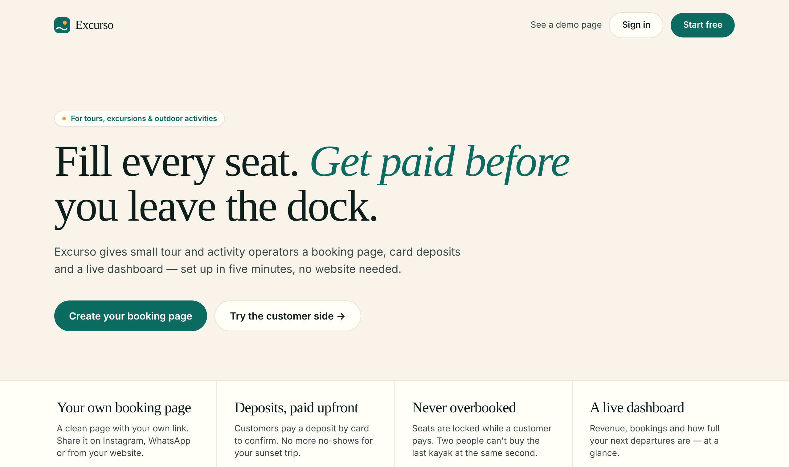
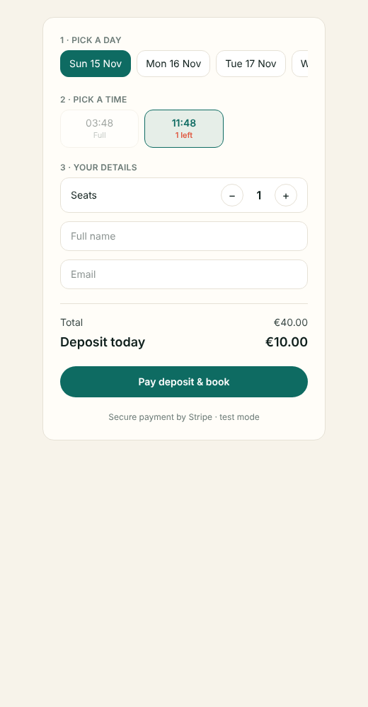

# Excurso

**Online booking, card deposits and a live dashboard for tour & activity operators.**

A full-stack SaaS: operators sign up, publish experiences (a kayak trip, a city tour…), open departures, and share a booking page. Customers pick a time, pay a deposit by card, and are confirmed instantly. Operators upgrade to a paid plan with a monthly subscription.



## What's inside

| Area | What it does |
|---|---|
| **Auth** | Email + password with Supabase Auth, confirmation link, protected dashboard (`proxy.ts` + server checks). |
| **Multi-tenant data** | Each business only ever sees its own data — enforced by **Postgres Row Level Security**, not just the UI. |
| **Booking engine** | Seats are reserved inside a transaction that **locks the departure row**, so two customers can never buy the last seat at the same time. Unpaid holds expire automatically. |
| **Payments** | Stripe Checkout for deposits. A booking is confirmed **only by a signed Stripe webhook**, never by the browser. Idempotent handlers (Stripe retries are safe). |
| **Subscriptions** | Free / Pro plans with Stripe Billing and the customer portal. The free-plan limit is enforced by a database policy. |
| **Dashboard** | Revenue, deposits, bookings, occupancy of upcoming departures, booking management. |



## Security decisions

- **RLS on every table.** Owners can only read and write rows of their own business.
- **Column-level grants.** Users can't write `plan` or Stripe ids on their own row — upgrading yourself to Pro from the browser console fails at the database. (This is exactly the privilege-escalation bug [RuleSight](https://github.com/kaerlix-maker/rulesight) detects.)
- **Public pages use an anonymous client** with column grants limited to what a booking page shows.
- **Server-only functions.** `reserve_seats` and `confirm_booking` can only be executed with the service role, from server code.
- **Late payments never overbook.** If a payment arrives after the hold expired and the seats were resold, the booking is flagged `needs_refund` instead of exceeding capacity.
- Inputs validated with Zod on the server; redirects after login are restricted to same-site paths.

## Tests

```bash
npm test          # unit tests (pricing, time zones, slugs) — node:test
npm run test:db   # 12 database tests: RLS isolation, column grants, plan limit,
                  # capacity, expiring holds, idempotent confirmation, late payments
npm run build     # type-checks and builds
```

The database tests run the real migration on a throwaway Postgres (`PGHOST`, `PGPORT`, `PGUSER` env vars) with a small stand-in for Supabase's `auth` schema.

## Tech

Next.js 16 (App Router, Server Actions) · TypeScript · Tailwind CSS 4 · Supabase (Postgres, Auth, RLS) · Stripe (Checkout, Billing, Webhooks) · Zod · Vercel

## Run it yourself

1. **Supabase** — create a project, open **SQL Editor**, paste `supabase/migrations/0001_init.sql`, run it.
   In **Authentication → URL Configuration**, set the Site URL to your deployed URL and add `https://YOUR-SITE/auth/callback` to Redirect URLs.
2. **Stripe** (test mode) — copy the secret key. In **Settings → Billing → Customer portal**, click *Save* once to enable the portal.
   Add a webhook endpoint `https://YOUR-SITE/api/stripe/webhook` with the events:
   `checkout.session.completed`, `checkout.session.async_payment_succeeded`, `checkout.session.expired`, `customer.subscription.updated`, `customer.subscription.deleted`.
3. **Environment** — copy `.env.example` to `.env.local` (or Vercel → Settings → Environment Variables) and fill it in.
4. `npm install && npm run dev`

Test card: `4242 4242 4242 4242`, any future date, any CVC.

## Known limits / roadmap

- Deposits go to the platform's Stripe account. A production version would use **Stripe Connect** so each operator is paid directly.
- Refunds are done from the Stripe dashboard; automatic refunds on cancellation are next.
- Seat holds could be abused by spam bookings — add rate limiting / CAPTCHA before going live.
- Email notifications to operators and customers (Stripe already sends the receipt).

## License

MIT © [Kaerlix](https://kaerlix-maker.github.io)
